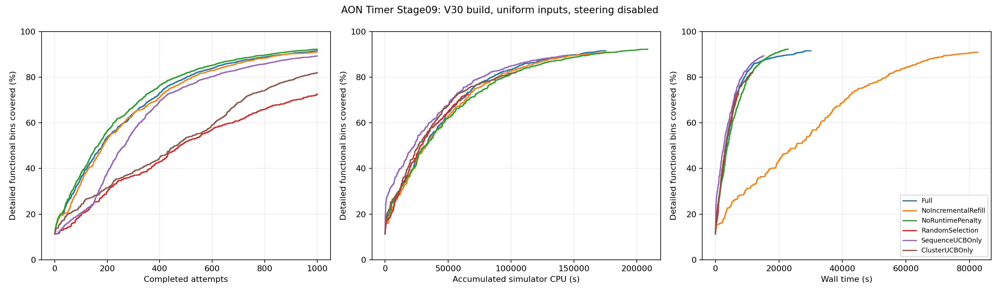

# 第十步最终复现索引

服务器复核时间：2026-11-14 17:45（Asia/Shanghai）。`verification.json` 为 `pass / complete=true`，六方法齐全；每方法完成 1000 次，全部原始文件复核通过。冻结复核程序本轮 8 项行为测试通过。

## 数据与方法入口

- [六方法预注册](../../../09_对照与消融/preregistration_v30_20261111.json)：相同 V30 build、39 条初始语料、508/4507 初始覆盖、751 个 cluster、seed 42、10 workers、每方法 1000 次，统一关闭 steering，不重试。
- [冻结输入副本](../../inputs/v30_20261112/README.md)、[复核程序](../../tools/verify_stage10_v30.py)、[行为测试](../../tests/test_stage10_v30.py) 与本目录 `source_sha256.txt` 的六个文件名一一对应。源码和输入哈希与服务器冻结记录相同。
- [方法定义与实现偏差](../../../09_对照与消融/V30统一环境对照与消融_20261111.md)：Full 为作者衍生实现，仍含 MI、分阶段 cluster 选择及 80% 目标/20% 全局序列奖励等已有差异。
- [最终矩阵、预注册与哈希](../../../09_对照与消融/evidence/stage09_v30_matrix_20261111/README.md)：汇总全部六种正式运行；30 次 smoke 为各方法的独立门禁，不并入正式预算。
- [最终复核](verification.json)、[论文参考差异 CSV](comparison.csv)、[测试记录](behavior_tests.txt) 与本目录 `sha256.txt` 构成最终交付。JSON 和比较 CSV 与服务器生成字节一致；本目录 README 修正了生成模板的旧等待文案，清单已重新计算。

## 逐方法审计入口

下列目录均含 `protocol.json`、`summary.json`、`events.jsonl`、`vectors.csv`、`run_results.json`、覆盖曲线，以及事件、原始 UVM、URG 并集和共享输入审计。各目录 `sha256.txt` 校验 12 个导出文件。

| 方法 | 正式证据目录 | 覆盖 bins/4507 |
| --- | --- | ---: |
| Full | [Full](../../../09_对照与消融/evidence/stage09_v30_Full_full1000_20261111/README.md) | 4125 |
| NoIncrementalRefill | [NoIncrementalRefill](../../../09_对照与消融/evidence/stage09_v30_NoIncrementalRefill_full1000_20261111/README.md) | 4096 |
| NoRuntimePenalty | [NoRuntimePenalty](../../../09_对照与消融/evidence/stage09_v30_NoRuntimePenalty_full1000_20261111/README.md) | 4156 |
| RandomSelection | [RandomSelection](../../../09_对照与消融/evidence/stage09_v30_RandomSelection_full1000_20261111/README.md) | 3274 |
| SequenceUCBOnly | [SequenceUCBOnly](../../../09_对照与消融/evidence/stage09_v30_SequenceUCBOnly_full1000_20261111/README.md) | 4023 |
| ClusterUCBOnly | [ClusterUCBOnly](../../../09_对照与消融/evidence/stage09_v30_ClusterUCBOnly_full1000_20261111/README.md) | 3695 |

曲线分别按完成次数、累计 simulator CPU 秒和实测 wall 秒比较。固定运行次数不等于相同时间预算；共享服务器负载和反馈顺序会影响 walltime。NoRuntimePenalty 最终多于 Full 31 bins，同时使用更多 simulator CPU；本次单 seed 不能证明统计显著优势。

## 重新检查与证据边界

从仓库根目录按[第十步运行说明](../../README.md)可重算六种方法的导出向量、奖励和曲线。未提供服务器原始文件时，工具将报告 `partial`；不会仅凭 GitHub 副本生成最终原始日志验收。

服务器最终输出位于项目根目录的 `evidence/stage10_v30_final_20261114/`；原始执行记录位于 `runs/stage09_v30_<方法>_full1000_20261111/`，冻结工具位于 `scratch/stage10_v30_review_20261112/`。真实 VDB、完整日志、simv 和许可证只保留服务器。本轮复核重新读取原始日志、execution 和 coverage counts；核对第九步已有 1039-VDB URG 合并审计，本轮没有再次启动 URG。

论文隐藏回归池、seed、覆盖分母和 runtime 定义尚未完全对齐，CSV 中的论文差值仅为描述性数字。scoreboard 使用有界中断到达窗口，尚非完整逐周期黄金模型。第八步开启 steering 的 V30 4127/4507 和旧解析器结果都保留为独立历史记录，不混入本矩阵。
